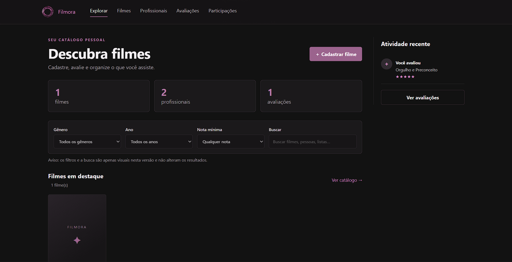

# Filmora — Catálogo de Filmes

Aplicação web acadêmica desenvolvida em Java e JSP para cadastrar filmes, profissionais do cinema e avaliações. Os dados são armazenados em arquivos JSON com Gson, sem banco de dados. A aplicação também registra participações para relacionar profissionais aos filmes.

**Projeto Prático — SPOLBP2 (Laboratório de Programação 2)**  
Instituto Federal de São Paulo  
**Autora:** Ana Julia Cardoso Moser

## Funcionalidades

- CRUD de filmes, profissionais e avaliações: incluir, listar, editar e excluir.
- Herança de profissionais: `Ator`, `Diretor` e `Roteirista` especializam a classe abstrata `Profissional`.
- Inclusão, listagem e remoção de participações entre filmes e profissionais.
- Exclusão dos vínculos de participação quando um filme ou profissional é removido.
- Exclusão das avaliações relacionadas quando um filme é removido.
- Página inicial com contagens e registros recentes.
- Os campos de busca e filtros da página inicial são apenas visuais e não filtram os resultados nesta versão.

## Entidades e relacionamentos

| Entidade | Atributos principais |
|---|---|
| **Filme** | `id`, `titulo`, `anoLancamento`, `genero` |
| **Profissional** | `id`, `nome`, `idade`, `tipo` (classe abstrata) |
| **Ator** | herda de `Profissional`; acrescenta `especialidadeVocal` |
| **Diretor** | herda de `Profissional`; acrescenta `estiloDirecao` |
| **Roteirista** | herda de `Profissional`; acrescenta `tipoRoteiro` |
| **Participacao** | `id`, `filmeId`, `profissionalId`, `funcao`, `personagem` |
| **Avaliacao** | `id`, `filmeId`, `nota`, `comentario`, `data`, `reassistido` |

Uma participação relaciona um filme a um profissional por seus identificadores. Uma avaliação referencia o filme por `filmeId`.

## Tecnologias

- Java 21 e JSP.
- Apache Tomcat 11.
- Gson 2.14.0 para converter objetos Java em JSON e JSON em objetos.
- Eclipse IDE com suporte a projetos Web (WTP).
- CSS para a apresentação das páginas.

## Como importar e executar no Eclipse

1. Extraia o projeto do ZIP.
2. No Eclipse, acesse **File > Import > General > Existing Projects into Workspace**.
3. Escolha a pasta extraída, selecione o projeto **Filmora** e conclua a importação.
4. Confira em **Properties > Targeted Runtimes** se o Tomcat está configurado. O projeto foi configurado para Java 21 e Tomcat 11; use versões compatíveis com essas configurações.
5. Verifique se a biblioteca `src/main/webapp/WEB-INF/lib/gson-2.14.0.jar` está presente.
6. Clique com o botão direito no projeto e escolha **Run As > Run on Server**.
7. Acesse `http://localhost:8080/Filmora/` no navegador. Se o contexto do servidor tiver outro nome, ajuste o endereço.

O servidor precisa ter permissão para gravar em `src/main/webapp/dados/`, onde os arquivos JSON são armazenados. Se os registros não forem salvos, confira o console do Eclipse e as permissões dessa pasta.

## Estrutura do projeto

```text
Filmora/
├── docs/
│   ├── DiagramaCasosdeUso.drawio.png
│   ├── DiagramadeClasses.png
│   ├── diagrama-casos-de-uso.puml
│   ├── diagrama-classes.puml
│   └── tutorial-gson.md
├── prints/
│   ├── ambiente-de-trabalho.png
│   ├── home-page-final.png
│   └── tela-inicial-rodando.png
├── src/main/java/
│   ├── excecao/       exceções da aplicação
│   ├── modelo/        Filme, Profissional, subclasses, Participacao e Avaliacao
│   ├── persistencia/  leitura e gravação dos JSONs com Gson
│   └── util/          caminhos e utilitários
├── src/main/webapp/
│   ├── css/           estilos da aplicação
│   ├── dados/         arquivos JSON
│   ├── img/           imagens, incluindo o logo
│   ├── includes/      cabeçalho e rodapé compartilhados
│   ├── WEB-INF/lib/   biblioteca Gson
│   └── *.jsp          página inicial e telas de cadastro
├── .gitignore
└── README.md
```

## Diagramas, tutorial e captura de tela

- [Diagrama de classes (PNG)](docs/DiagramadeClasses.png)
- [Diagrama de casos de uso (PNG)](docs/DiagramaCasosdeUso.drawio.png)
- [Fonte PlantUML do diagrama de classes](docs/diagrama-classes.puml)
- [Fonte PlantUML dos casos de uso](docs/diagrama-casos-de-uso.puml)
- [Tutorial de Gson](docs/tutorial-gson.md)

As fontes PlantUML existentes devem ser conferidas e alinhadas às operações implementadas antes de gerar novamente os diagramas finais.



## Arquivos JSON

Os arquivos de dados ficam em `src/main/webapp/dados/`:

- `filmes.json`: filmes.
- `profissionais.json`: profissionais; o campo `tipo` identifica `ATOR`, `DIRETOR` ou `ROTEIRISTA`.
- `participacoes.json`: vínculos entre `filmeId` e `profissionalId`, com função e personagem.
- `avaliacoes.json`: avaliações com `filmeId` numérico.

Faça uma cópia de segurança antes de substituir ou editar manualmente os arquivos. Para entender a persistência e os exemplos com Gson, consulte o [tutorial](docs/tutorial-gson.md).
