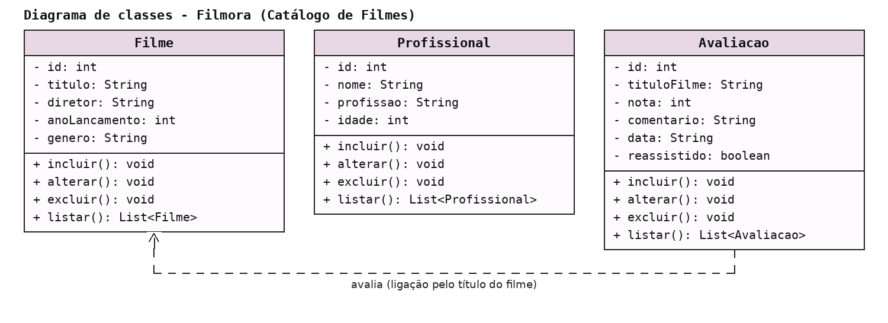

# Filmora — Catálogo de Filmes

Aplicação web inspirada no Letterboxd, para quem gosta de acompanhar e avaliar filmes.
Permite cadastrar filmes e profissionais (elenco, direção, roteiro) e registrar avaliações
com nota, comentário, data e indicação de "reassistido".

Projeto Prático — SPOLBP2 (Laboratório de Programação 2), Instituto Federal de São Paulo.
Autora: Ana Julia Cardoso Moser.

## Entidades

| Entidade | Atributos |
|---|---|
| **Filme** | id, titulo, diretor, anoLancamento, genero |
| **Profissional** | id, nome, profissao, idade |
| **Avaliacao** | id, tituloFilme, nota, comentario, data, reassistido |

Cada entidade tem os métodos `incluir()`, `alterar()`, `excluir()` e `listar()`.

## Tecnologias

- Java e JSP
- Servidor Apache Tomcat
- Gson (leitura e gravação de arquivos JSON)
- Arquivos JSON como armazenamento (sem banco de dados)
- Eclipse (Dynamic Web Project)

## Diagrama de classes



## Como rodar

1. Clone o repositório:
   `git clone https://github.com/anacmoser/sp3150747Filmora.git`
2. No Eclipse: **File > New > Dynamic Web Project**
   - Nome: `Filmora`
   - Desmarque **Use default location** e escolha a pasta do repositório clonado
   - Target runtime: Apache Tomcat
   - Content directory: `src/main/webapp`
3. Confirme que o `gson-2.x.x.jar` está em `src/main/webapp/WEB-INF/lib`
   (veja [docs/tutorial-gson.md](docs/tutorial-gson.md)).
4. Clique com o botão direito no projeto > **Run As > Run on Server**.
5. Abra `http://localhost:8080/Filmora/` — a tela inicial mostra quantos registros
   a Gson leu dos arquivos JSON.

## Estrutura do repositório

```
sp3150747Filmora/
├── src/
│   └── main/
│       ├── java/            classes Java (modelo, persistencia, excecao, util)
│       └── webapp/          JSPs, CSS, includes e pasta dados/ (JSON)
│           └── WEB-INF/lib/ biblioteca Gson (gson-2.14.0.jar)
├── docs/                    diagrama de classes e tutoriais
├── prints/                  capturas de tela da evolução do projeto
├── apresentacao/            slides da apresentação do 4º bimestre
└── README.md
```